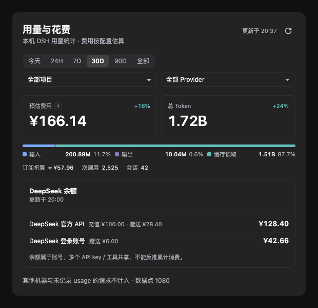
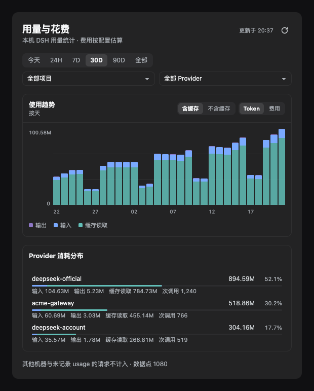
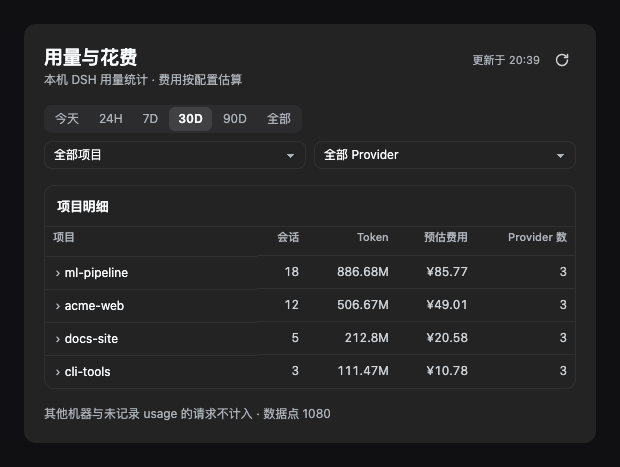

# dsh-usage-dashboard

**English** · [简体中文](README.zh-CN.md)

A usage and cost dashboard for **DeepSeek Harness (DSH)**: token and call counts broken down by project, provider and model, cost estimated from your local price config, and your DeepSeek account balance — all on one screen inside *Settings → Usage & Cost*.

> Screenshots use **synthetic demo data** — no real account information.



## Features

- **Two primary KPIs plus one composition bar** — estimated cost, total tokens, and the input / output / cache-read split in a single glance.
- **Ranges** — Today, rolling 24H, 7D, 30D, 90D, All, custom. `24H` is a rolling window and is *not* the same as "today".
- **Three combinable filters** — project, provider, model. Click a provider row or a project row to drill in.
- **Trend chart** — toggle between tokens and cost; toggle cache in or out (cache is usually >95% of all tokens, so hiding it is the only way to see the input/output shape).
- **Provider breakdown** — input / output / cache / call count per provider, with the bar segmented by composition.
- **Project table** — expand a row to see which providers that project used, with tokens and cost each.
- **Balance** — DeepSeek API-key wallet and logged-in account wallet on separate rows, with top-up and bonus listed apart.
- **Floating card** — pinned bottom-right on the chat page, collapsed to a `Today ¥3.42 · 1.2M` pill; expand for today's breakdown and balance. Draggable, position remembered.
- **Refresh policy** — refreshes only when you open the settings page, expand the card, or click refresh. **No background polling**: a full scan costs ~12s, so an idle page must not burn CPU. Data older than 10 minutes is dimmed as a staleness cue.

<details>
<summary>More screenshots</summary>





</details>

## Install

Requires a DSH build that ships the `dsh plugin` subcommand (tested on `0.2.1-rc.2`).

```bash
# replace "desktop" with your profile name (desktop / web)
dsh plugin --profile desktop add github:Zhangw1998/dsh-usage-dashboard
```

Reload DSH, then open **Settings → Usage & Cost**.

Uninstall: `dsh plugin --profile desktop remove dsh-usage-dashboard`

## How the numbers are computed

These are deliberate honesty choices, and they matter more than the charts:

| Label | What it is | What it is *not* |
|---|---|---|
| **Estimated cost** | Per-token cost estimated from your local price config, including peak/off-peak bands | **Not a billed amount** — no billing records are read |
| **Plan value** | Subscription usage valued at list prices, prefixed with `≈` | **Not money spent**, and never added to estimated cost |
| **Unpriced** | Models with no rule in the price config | **Not zero** — unpriced usage is counted separately and never priced at 0 |
| **Calls** | Calls that carried a usage report | Failed or usage-less requests are not counted, so this can be lower than your provider's dashboard |
| **Balance** | Account wallet balance | **Cannot be used to infer cumulative spend** — one balance is shared by many keys/tools |

- **Currencies are never summed across** — each currency gets its own line.
- **Every view reconciles under the same filters** — KPIs, trend, provider ranking and project table all aggregate from one filtered fact table, so totals and detail cannot disagree.
- **No data means no data** — an empty range renders an explicit empty state, not a flat zero chart.

## Privacy and network access

Everything this plugin does on your machine, in full:

1. **Reads local session logs** — scans `~/.dsh/sessions/**/session.v4.jsonl.zstd` (or `$DSH_HOME/sessions`) to extract per-call token usage. Conversation content is never uploaded and never copied into this plugin's output.
2. **Makes one balance request** — only if `DEEPSEEK_API_KEY` is configured, it calls `https://api.deepseek.com/user/balance` with that key. **That is the only host it ever contacts**, and redirects are refused.
3. **Writes two files** — under `~/.dsh/storages/`: the scan cache and the price config. No session data is written.

No telemetry, no third-party reporting.

## Pricing config

Default rules live in `pricing.js`. To override, edit:

```
~/.dsh/storages/usage-dashboard-pricing.json
```

Per-provider peak/off-peak rates, currency and billing mode (`token` / `plan` / `subscription` / `unknown`) can be overridden. The file is validated before it is applied — invalid config is rejected rather than partially applied.

## Development

No dependencies; Node ≥ 22 only.

```bash
node --test test/*.test.mjs   # 78 tests
node build-client.mjs         # re-inline chart-kit.js + view-model.js into client.js
```

- `client.js` is a build artifact and must stay committed — installing from git performs no build step (`prepare` covers it anyway).
- Preview the sanitized screenshots with synthetic data (serve from the repo root):

```bash
python3 -m http.server 8899
# open http://127.0.0.1:8899/docs/demo.html
```

- Code layout:
  - `usage.js` — parses session logs into an hourly fact table (tokens, call counts, cost already computed)
  - `view-model.js` — the single aggregation layer: time windows, granularity, composable filters, period comparison
  - `chart-kit.js` — components and design system (theme tokens only; light and dark follow automatically)
  - `client.js` — the browser half, generated by inlining the two modules above
  - `host.js` — the host half, registering the `/api/usage.dashboard*` endpoints

## Known limitations

- **A full scan takes ~10–15 s** (it replays every session log), so refresh happens on entry/expand/manual only — no timer. If you leave the settings page open, the numbers stay frozen until you refresh.
- **Session counts are exact only without filters** — the host does not bucket sessions by time, so that column shows `—` under a project/provider filter instead of a wrong number.
- **Balance is DeepSeek-only** — `deepseek-official` (API-key wallet) and `deepseek-account` (logged-in wallet). Other providers have no balance adapter.
- Weekly aggregation for 90D is implemented but needs enough history to show more than one bar.

## License

MIT
